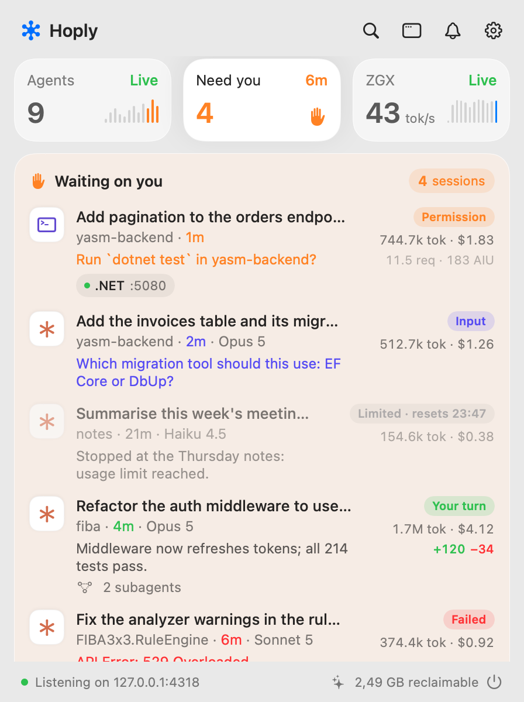

# Hoply

**A Mac menu bar app that shows what your AI coding agents are doing, what they cost, and when they need you.**

Hoply watches Claude Code, Codex CLI, Copilot CLI, Copilot in JetBrains and Qwen Code, plus the model servers you run
yourself. It groups live sessions by repository, moves any session that is waiting on you to the top, and keeps its
own usage history, so you can see what each run cost and how much of your Claude plan is left. It's for people who
run several agents at once and would rather not keep checking terminals. Everything stays on your Mac.

<p align="center">
  <picture>
    <source media="(prefers-color-scheme: dark)" srcset="docs/images/panel-dark.png">
    <source media="(prefers-color-scheme: light)" srcset="docs/images/panel-light.png">
    
  </picture>
</p>

## Install

- **Download** the DMG from [hoply.dev/download](https://hoply.dev/download), open it and drag Hoply to Applications.
- **Or use Homebrew:** `brew install --cask milos5611/hoply/hoply`

You need macOS 14 Sonoma or newer, on Apple silicon or Intel (it's one universal app); the Liquid Glass look needs
macOS 26 Tahoe. Release builds are signed with a Developer ID and notarized by Apple, so macOS asks only its usual
one-time question for an app from the internet.
Hoply is free during early access.

**Updates.** Hoply checks for a new version at launch and twice a day and shows it at the bottom of the panel. Nothing
installs until you choose it. You can turn the check off in Settings → Updates; "Check for Updates…" is also in the menu
bar icon's right-click menu. The Homebrew cask is marked `auto_updates`, so `brew upgrade` leaves Hoply to its own
updater unless you pass `--greedy`.

**Uninstall.** First disconnect your agents in Settings → Agents, which removes Hoply's hooks from their config, then
delete the app. `brew uninstall --zap --cask hoply` also deletes Hoply's data, usage history included, but it doesn't
remove the agent hooks.

## First run

1. Click the Hoply icon in the menu bar, then the gear. **Settings → Agents** lists the agents Hoply found. Press
   **Connect** on each one you use.
2. Restart any agent session that was already running, so it picks up the hooks.
3. Using Codex CLI? Open Codex, run `/hooks` and trust Hoply's hooks. Codex runs a hook only after you trust it.

That's it: start an agent and its session shows up in the panel within a second. Here's what Connect writes:

- **Claude Code:** hooks and OpenTelemetry log settings in `~/.claude/settings.json`.
- **Codex CLI:** hooks in `~/.codex/hooks.json`.
- **Copilot CLI:** a hooks file at `~/.copilot/hooks/hoply.json`. Disconnect renames it instead of deleting it.
  Copilot's agent in JetBrains IDEs runs the same hooks, so its sessions show up too, as Copilot CLI.

Hoply backs a file up before changing it, keeps your own hooks and settings, and touches only its own entries, so
connecting again is safe. If you change Hoply's port, the Agents card says Update, and pressing it rewrites the hooks
(Codex then asks you to trust them again). If your agent config lives somewhere else (`CLAUDE_CONFIG_DIR`,
`CODEX_HOME`, `COPILOT_HOME`), set the folders in Settings → History.

Copilot in JetBrains, Qwen Code, model servers and Claude plan limits take one more step each; see
[Manual setup](#manual-setup).

## What it does

- **Live sessions** for Claude Code, Codex CLI, Copilot CLI, Copilot in JetBrains and Qwen Code, grouped by
  repository (worktrees and subfolders share a card). Each row shows the state (working, your turn, needs permission,
  limited, ended), the task, the model, the last tool, tokens and cost, plus live subagents, a context-window warning
  and the branch's git diff.
- **Waiting on you.** Sessions that need you move to the top of the panel, with a notification that says why: a
  permission prompt, a question, a finished turn, a usage limit or an error. A turn shorter than 10 seconds ends
  without one (Settings → Notifications sets the delay, or Always), and quiet hours and per-project mute keep it calm.
- **Approve from Hoply** (off by default). Allow and Deny buttons for Claude Code permission prompts, in the panel and
  on the notification. Your terminal keeps its own prompt.
- **Usage history and cost.** API-equivalent cost per project, model, day and agent, from a local database that
  outlives the agents' own records. Copilot's premium requests and AI units come straight from Copilot.
- **Local model servers.** vLLM, tensorfold, llama.cpp, SGLang, TGI, Ollama, LM Studio and other OpenAI-compatible
  servers, local or remote: speed, KV cache, running and queued requests, tokens per day, and what those tokens would
  have cost on the API.
- **Claude plan limits.** The 5-hour and weekly windows (including model-specific weekly ones), your pace against the
  clock, burn rate, a projection at reset, and alerts at 80% and 95%.
- **Dev servers.** The ports your agent sessions started, tied back to the session, with a Stop button.
- **Clean up.** Merged worktrees, large build caches, old transcripts already in Hoply's history, and processes an
  agent left running. Nothing goes without a review sheet, and files go to the Trash.
- **Command palette** on ⌥Space, from any app: sessions, projects, dev servers, Dashboard pages and actions. Resume a
  finished session in Terminal.
- **A Dashboard window** with Overview, Projects, Sessions, Spending, Local model, Limits, Dev servers and Clean up
  pages.

### What each source reports

| Source | How Hoply hears from it | What you see |
|---|---|---|
| Claude Code | hooks for state; usage from its transcripts (its OpenTelemetry logs add live counts) | working / needs permission / your turn, task title, last tool, tokens, cost |
| Codex CLI | hooks for state; usage from its session files in `~/.codex/sessions` | working / needs permission / your turn, last tool, tokens, API-equivalent cost |
| Copilot CLI (and Copilot's agent in JetBrains) | hooks for state; usage from its own `~/.copilot/session-store.db` and each session's `~/.copilot/session-state/<id>/events.jsonl` | working / needs permission / your turn, task title, model, last tool, AI units, premium requests |
| Copilot in JetBrains | OpenTelemetry, when its agent doesn't run the Copilot CLI hooks | working / idle, tokens |
| Qwen Code | OpenTelemetry, stored by Hoply | working / idle, prompt title, tokens |
| Model servers | Prometheus `/metrics` or the server's model list | model, running and queued requests, tokens/s, KV cache |
| Claude plan | your own Claude Code login, read from the Keychain | 5-hour and weekly usage, pace, reset times |

Anything else that talks to your model server, such as a chat app, shows up in that server's card too.

## Privacy

- Hoply's listener is bound to `127.0.0.1` and turns away any connection that isn't from your Mac.
- No account, no analytics, no crash reporter. Nothing your agents do is sent anywhere.
- Hoply makes three kinds of outgoing request:
  - to the **model servers you add**;
  - to **Anthropic's usage endpoint**, with your own Claude Code login, for the Claude limits card. This only starts
    once you press Connect there, and macOS asks you before Hoply may read that Keychain item;
  - an **update check** at `https://hoply.dev/appcast.xml`, at launch and twice a day (release builds only; Settings →
    Updates turns it off).
- Agent records (transcripts, Codex session files, Copilot's database and session files) are read, never changed.
  The two exceptions are things you ask for: Connect writes the hook config above, and Clean up moves what you tick
  to the Trash.
- Usage history lives in `~/Library/Application Support/Hoply/hoply.sqlite`. Model-server tokens and passwords live in
  your Keychain, never in settings, URLs or logs.

More detail in the [privacy policy](https://hoply.dev/privacy).

## Manual setup

Settings → Agents connects Claude Code, Codex CLI and Copilot CLI. Everything else is set up here. The
[setup guide](https://hoply.dev/guide) has the same steps with more context.

**Copilot in JetBrains.** Open Settings → Tools → GitHub Copilot → Chat, turn on the OpenTelemetry export, and set
the OTLP endpoint to `http://127.0.0.1:4318` (HTTP). JSON and protobuf both work.

**Qwen Code.** Add this to `~/.qwen/settings.json`:

```json
"telemetry": { "enabled": true, "otlpEndpoint": "http://127.0.0.1:4318", "otlpProtocol": "http" }
```

Qwen's OpenTelemetry is its only usage record, so Hoply stores it. To file usage under the right project, start Qwen
with `OTEL_RESOURCE_ATTRIBUTES=hoply.cwd=$PWD`. Without it, Hoply asks Qwen's process (`process.pid`) for its working
directory, and usage it can't place shows as "Unassigned".

**Model servers.** Settings → Model servers → **Add server…** (it opens in the Dashboard window, which stays up while
you copy a key), or **Find servers on this Mac**. Use the server's base URL without `/metrics`, for example
`http://192.168.1.20:8000`; Hoply reads `<url>/metrics` or the server's model list. Plain http works for loopback,
private-range addresses, `.local` names, Tailscale and similar local names (App Transport Security exceptions in the
app's `Info.plist`); public hosts need https. macOS asks once for Local Network access. Hoply polls each server every
5 seconds while the panel or Dashboard is open, every 30 seconds otherwise.

**Claude plan limits.** Press Connect on the Claude limits tile in the panel, or on the Dashboard's Limits page.
macOS asks once whether `security` may read the "Claude Code-credentials" Keychain item; choose Always Allow. If it
says the login expired, open Claude Code once and it refreshes the token.

**Codex OpenTelemetry (optional).** Codex's session files already give Hoply its usage. For live token counts as well,
add an `[otel]` exporter to Codex's `config.toml`: `otlp-http` with `protocol = "json"` and the endpoint
`http://127.0.0.1:4318/v1/logs`. Hoply never writes `config.toml` itself.

**Check that events arrive.** The panel footer says "Listening on 127.0.0.1:4318", or why it isn't. If another
OpenTelemetry collector already has port 4318, change the port in Settings → Listener, then press Update on each
agent in Settings → Agents. From a terminal:

```bash
curl -s http://127.0.0.1:4318/health
```

## Good to know

<details>
<summary><b>How usage and cost are counted</b></summary>

Hoply keeps its own usage history in `~/Library/Application Support/Hoply/hoply.sqlite`, with one source per agent so
nothing is counted twice:

- **Claude Code:** the transcripts under `~/.claude/projects` (read-only), subagents included. So Hoply has history
  from before you installed it, and it works with OpenTelemetry off. Claude Code deletes transcripts after about 30
  days; Hoply never deletes usage rows, so its history outlives them.
- **Codex CLI:** its session files under `~/.codex/sessions` and `~/.codex/archived_sessions` (or `$CODEX_HOME`),
  read-only, so this also has history from before Hoply. A call's tokens are the growth of the session's running
  total, and a forked session's copy of its parent's calls is counted once. Prices are API-equivalent: a ChatGPT plan
  doesn't bill per token, and the files don't say whether a call ran in a faster, dearer tier.
- **Copilot CLI:** its own `~/.copilot/session-store.db` (or `$COPILOT_HOME`), read-only, checked every 10 seconds,
  and each session's `~/.copilot/session-state/<id>/events.jsonl`, read as it grows. Copilot's agent in JetBrains
  writes only the session files. A session's usage comes from whichever of the two recorded it first, so it is never
  counted twice. Copilot prices each call in AI units (AIU), and 1 AIU is $0.01 at API list price, so Hoply uses
  Copilot's figure as the cost and also shows AIU and premium requests; a call without AI units (a model such as Kimi
  K3) is priced from the table, or shows as unpriced. Settings → Copilot plan sets your monthly allowance and the price
  of extra requests.
- **Copilot in JetBrains and Qwen Code:** the OpenTelemetry they send to Hoply, stored as it arrives. Re-sent batches
  are recognized by their ids and counted once.

Costs are API-equivalent list prices from a table bundled in the app. Local models (any model whose name contains
`qwen`; change it in Settings → History) cost $0, and are also priced at a reference model (default
`claude-sonnet-5-5`) to show what they saved. A model Hoply doesn't know shows as unpriced, never as $0; Settings →
Pricing lets you price it as a model it does know. To add or correct a price, put the same shape as the bundled table
in `~/Library/Application Support/Hoply/pricing.json`, in USD per million tokens:

```json
{ "models": { "claude-opus-4-5": { "input": 5, "output": 25 } } }
```

Cache prices default to 0.1× input for a read, 1.25× for a 5-minute write and 2× for a 1-hour write. You can set
`cacheRead`, `cacheWrite5m`, `cacheWrite1h`, `fast` and `longContext` per model.

</details>

<details>
<summary><b>Approve from Hoply</b></summary>

Settings → Notifications → "Approve Claude Code prompts from Hoply" (off by default) adds Allow and Deny to a Claude
Code session's permission prompt, in the panel and on its notification. It needs Hoply's current `PermissionRequest`
hook: if Settings → Agents shows Claude Code as needing an update, press Update once.

- Hoply holds the hook's reply until you click, for at most 9½ minutes. Allow answers that one request (no rule is
  saved); Deny tells Claude you declined and lets it carry on.
- The terminal prompt stays up the whole time, and whichever answers first wins. If you answer in the terminal, the
  buttons go away once Claude Code moves on or cancels the hook.
- With the setting off, or with Hoply not running, the hook returns nothing and Claude Code's own prompt decides as
  before.
- Questions (`AskUserQuestion`) and plan approval (`ExitPlanMode`) are never offered: they need your answer, not a
  yes.
- Copilot CLI and Codex CLI aren't supported: their permission hooks run before their own rules and prompt, so holding
  one would stall every tool call.
- The Allow button on a notification asks macOS to unlock first.

</details>

<details>
<summary><b>Clean up</b></summary>

The Dashboard's Clean up page lists what Hoply thinks is safe to remove, and what it keeps and why. Nothing is
removed until you tick it and confirm the review sheet, and each item is checked again right before it goes.

- **Worktrees:** linked git worktrees that are merged into the default branch, clean, unlocked and idle for a week,
  with no session or dev server in them. The folder moves to the Trash and git forgets the worktree; the branch stays.
  Squash-merged branches count as unmerged and are kept.
- **Build caches:** `.next`, `.turbo`, `.build`, `target` and the like, over 50 MB, in projects idle for two weeks. In
  a repo the folder must be gitignored. `node_modules` is opt-in.
- **Claude transcripts:** sessions older than 90 days that are fully in Hoply's history. The usage stays in Hoply;
  Claude Code can no longer resume those sessions.
- **Orphan processes:** processes an agent session started and left running after it ended. These are stopped, not
  trashed.

Files go to the Trash, so Finder's Put Back works.

</details>

<details>
<summary><b>Command palette</b></summary>

⌥Space opens a search field over whatever app is in front: live and recent sessions, projects, dev servers, Dashboard
pages and actions. Type `>` to list actions only. Return runs the highlighted row and ⌘Return its second action;
things you pick often rank higher.

- **Resume:** Return on a finished Claude Code, Codex CLI, Copilot CLI or Qwen Code session writes a small `.command`
  script (`cd` into the session's folder, then the agent's own resume command, such as `claude --resume <id>`) to
  `~/Library/Application Support/Hoply/Resume/` and opens it in Terminal. Copilot in JetBrains sessions open in the
  Dashboard instead. A live session is never resumed.
- **Shortcut:** change it or turn the palette off in Settings → Command palette, which also shows whether the shortcut
  has fired. If ⌥Space does nothing, macOS or another app owns it; use ⌃⌥Space or record another combination. The
  panel's search button and the menu bar icon's right-click menu open the palette too.

</details>

<details>
<summary><b>Known limitations</b></summary>

- The Claude limits card uses `api.anthropic.com/api/oauth/usage`, the undocumented endpoint behind Claude Code's
  `/usage`. It can change without notice.
- Copilot in JetBrains through OpenTelemetry alone, and Qwen Code, have no hooks Hoply can use, so they show only
  working and idle, never "needs permission" or "your turn".
- OTLP over gRPC and gzip-compressed bodies aren't supported; use HTTP without compression.
- Codex CLI's session files are an internal format that changes between versions. Hoply is tested against files from
  Codex 0.98 and 0.144.
- Cursor runs the hooks in `~/.claude/settings.json` too. Hoply ignores those calls (they carry `cursor_version`)
  rather than showing them as Claude Code sessions.
- Claude Code's own `cost-state` totals include calls it never writes to the transcript (title generation, web search,
  and in subagent-heavy sessions much more), so Hoply's per-session totals are usually a few percent lower.

</details>

## Build from source

You need macOS 26 or newer and Xcode 27. There's no Xcode project; it's a Swift package.

```bash
git clone https://github.com/Milos5611/hoply.git
cd hoply
swift build
swift run Hoply           # runs unbundled; the icon appears in the menu bar
scripts/install.sh        # builds Hoply.app into ~/Applications, connects your agents, opens it
```

Builds from source never update themselves, and notifications and launch at login only work in the bundled app from
`scripts/install.sh`. [CONTRIBUTING.md](CONTRIBUTING.md) has the rest: tests, snapshots, simulated traffic and how
the code is laid out.

## Contributing

Bug reports and pull requests are welcome. Start with [CONTRIBUTING.md](CONTRIBUTING.md). Found a security problem?
Please follow [SECURITY.md](SECURITY.md) and report it privately instead of opening an issue.

## License

The code is MIT; see [LICENSE](LICENSE).

**Name and icon.** The license covers the code, not the Hoply name or app icon (`Sources/Hoply/Hoply.icon` and the
matching `HoplyMark` glyph), which identify the official app. If you ship a fork or a build of your own, give it its
own name and icon, so nobody mistakes it for an official release.

Hoply is an independent project. It isn't affiliated with, endorsed by or sponsored by Anthropic, OpenAI, GitHub or
Microsoft. Claude, Claude Code, Codex, GitHub and Copilot are trademarks of their owners and are named here only to say
what Hoply works with.
